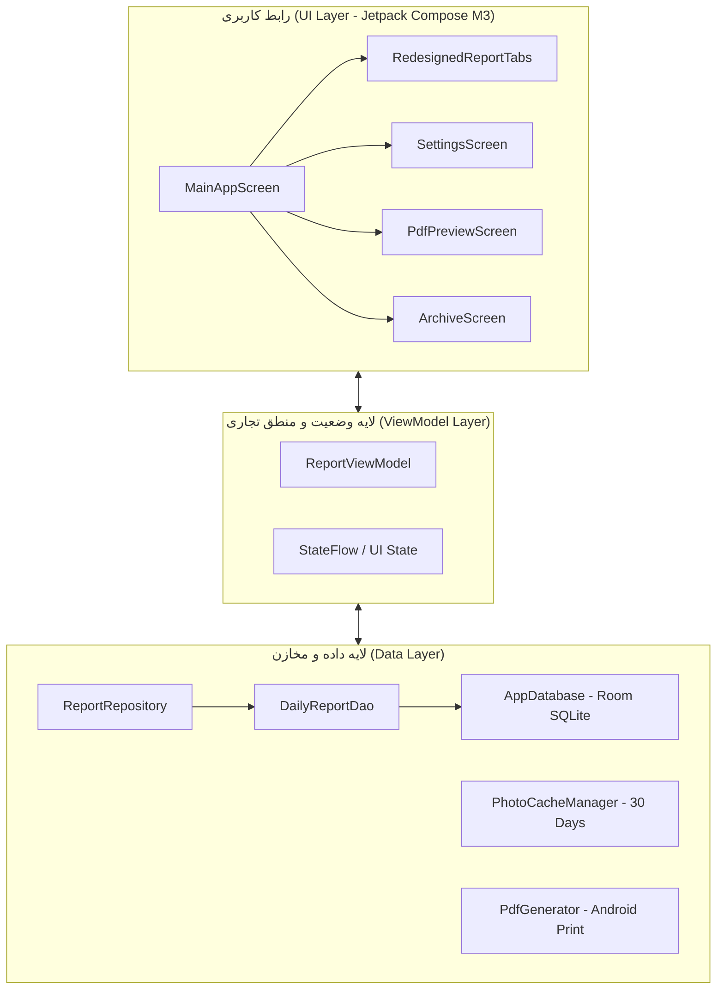

<div align="center">


### دستیار تخصصی، هوشمند و آفلاین مهندسین کارگاه، سرپرستان کارگاه و ناظران پروژه‌های عمرانی

[-3DDC84?style=for-the-badge&logo=android&logoColor=white)](https://developer.android.com)
[](https://kotlinlang.org)
[](https://developer.android.com/jetpack/compose)
[](https://developer.android.com/training/data-storage/room)
[](#)
[](LICENSE)

</div>

---

## 📋 معرفی پروژه

**«گزارش‌یار کارگاه» (BuildReport)** یک اپلیکیشن کاملاً بومی، مدرن و اختصاصی برای سیستم‌عامل اندروید است که با تکیه بر متدهای مهندسی عمران، راهسازی، ابنیه و تأسیسات طراحی شده است. این نرم‌افزار به مهندسان کارگاه، سرپرستان کارگاه، ناظران و کارشناسان فنی امکان می‌دهد تا در کمترین زمان ممکن، گزارش‌های روزانه کارگاه را همراه با محاسبات دقیق، کیلومتراژ استاندارد، کنترل نیروی انسانی و ماشین‌آلات، ثبت مستندات تصویری واترمارک‌شده و خروجی رسمی PDF بدون نیاز به اینترنت تهیه نمایند.

---

## ✨ ویژگی‌های برجسته در نسخه ۳.۱.۰

```
┌────────────────────────────────────────────────────────────────────────┐
│                        ویژگی‌های جدید نسخه 3.1.0                        │
├───────────────────────────────────┬────────────────────────────────────┤
│ ⚙️ مشخصات ثابت در تنظیمات         │ 📋 کپی هوشمند از گزارش دیروز       │
│ 🔢 شماره‌گذاری خودکار (پایه ۱۰۰)   │ 📸 واترمارک کارگاهی و آرشیو ۳۰ روزه│
│ 🚜 تفکیک مالکیت ماشین‌آلات        │ ⬆️⬇️ جابجایی، ویرایش و حذف ردیف‌ها │
└───────────────────────────────────┴────────────────────────────────────┘
```

### ۱. تنظیمات پایدار پروژه و پرسنل (پیکربندی یک‌باره)
- **مشخصات عمومی ثابت**: نام پروژه، واحد سازمانی گزارش‌دهنده (اجرا، دفتر فنی، نظارت، HSE، نقشه‌برداری)، نام نویسنده/سرپرست کارگاه و امضای دیجیتال تنها یک‌بار در صفحه تنظیمات مشخص می‌شوند.
- **حذف دوباره‌کاری**: در ثبت گزارش روزانه، این مشخصات تکراری درخواست نمی‌شوند و مستقیماً روی سربرگ گزارش و خروجی PDF قرار می‌گیرند.
- **شماره گزارش خودکار**: امکان تعیین شماره گزارش پایه (پیش‌فرض ۱۰۰). با ثبت هر گزارش جدید، سیستم به صورت کاملاً خودکار شماره را یک واحد افزایش می‌دهد (`... ،102 ،101 ،100`).

### ۲. کپی هوشمند از گزارش دیروز (Smart Carry-Over)
- برای تسریع ثبت گزارش‌های پیاپی، با لمس دکمه **«کپی از گزارش قبلی»**، تمامی فعالیت‌های مستمر، پرسنل حاضر، ماشین‌آلات فعال و مصالح در گردش روز قبل با یک لمس به فرم امروز منتقل می‌شوند و کاربر فقط تغییرات جزئی را اعمال می‌کند.

### ۳. مستندسازی تصویری با واترمارک کارگاهی و ماندگاری ۳۰ روزه
- **واترمارک کارگاهی خودکار**: هر تصویری که به گزارش پیوست می‌شود، بلافاصله مجهز به نوار مشکی متادیتای مهندسی شامل تاریخ شمسی، زمان دقیق ثبت و کیلومتراژ/موقعیت کارگاه می‌گردد.
- **ذخیره‌سازی پایدار ۳۰ روزه در حافظه امن**: عکس‌ها در فضای پایدار برنامه ذخیره شده و پس از ۳۰ روز به طور خودکار جهت مدیریت حجم گوشی پاک‌سازی می‌شوند.

### ۴. تفکیک پیشرفته مالکیت ماشین‌آلات و ثبت دستی توضیحات
- امکان تعیین نوع مالکیت هر دستگاه:
  - 🏢 **شرکتی (ملکی)**
  - 🤝 **استیجاری (اجاره‌ای)**
  - 🏗️ **پیمانکار دست دوم**
- فیلد اختصاصی **«توضیحات و خرابی»** به صورت متن آزاد برای ثبت سرویس‌های دوره‌ای، شیفت‌های کاری یا ساعت‌های خواب دستگاه.

### ۵. مدیریت منعطف ردیف‌ها (Reorder, Edit, Delete)
- امکان مرتب‌سازی صعودی/نزولی ردیف‌ها با دکمه‌های انتقال (⬆️ و ⬇️) در بخش‌های:
  - فعالیت‌ها و احجام کاری
  - نیروی انسانی و اکیپ‌ها
  - ماشین‌آلات سنگین و سبک
  - مصالح و متریال وارده
- ویرایش در لحظه (In-place Edit) و حذف با تأیید برای جلوگیری از اشتباه.

### ۶. فرمت‌دهی استاندارد متراژ و کیلومتراژ راهسازی ($K+M$)
- سیستم به صورت بلادرنگ ورودی‌های عددی نظیر `250` یا `3500` را به صورت مهندسی `0+250` یا `3+500` تبدیل می‌کند.
- در فایل‌های PDF و پیش‌نمایش، با معماری پیشرفته LTR/RTL ایزوله شده، متون فارسی و عبارات کیلومتراژ هرگز دچار به‌هم‌ریختگی نمی‌شوند.

### ۷. خروجی رسمی و بدون اینترنت PDF کارگاهی
- تولید کامل سند PDF به همراه جدول‌بندی استاندارد عمرانی، درج خودکار لوگوی پروژه، جدول خلاصه پرسنل و ماشین‌آلات، ۴ تصویر مستندات به همراه واترمارک و بخش امضای الکترونیک.

---

## 🏗️ معماری نرم‌افزار و پشته فنی

این برنامه بر اساس معماری توصیه‌شده گوگل (**Modern Android Architecture - MVVM**) و الگوی **Offline-First** پیاده‌سازی شده است:



### تکنولوژی‌ها و کتابخانه‌ها:
- **Language**: Kotlin 1.9+
- **UI Toolkit**: Jetpack Compose 1.5+ همراه با Material Design 3
- **Local Database**: Room 2.6+ (SQLite با مدیریت دقیق Migration)
- **Asynchronous**: Kotlin Coroutines & Flow (StateFlow / SharedFlow)
- **PDF Generation**: Android Print Framework & Native WebView Rendering
- **Typography**: فونت استاندارد وزیرمتن (Vazirmatn) لود شده به صورت آفلاین از منابع نرم‌افزار

---

## 📱 پیش‌نمایش نسخه تعاملی (HTML Prototype)

یک نسخه پروتوتایپ کامل موبایلی بر اساس ابعاد گوشی‌های هوشمند مدرن طراحی شده که بدون نیاز به کامپایل اندروید استودیو در هر مرورگری اجرا می‌شود:
- فایل پروتوتایپ: `BuildReport_v3.1.0_Prototype.html`
- وکتور اختصاصی لوگو: `BuildReport_Logo_v3.1.0.svg`

---

## 🚀 راهنمای نصب و کامپایل پروژه

### نیازمندی‌ها:
- **Android Studio**: نسخه Hedgehog (2023.1.1) یا نسخه‌های جدیدتر (Iguana, Jellyfish, Koala)
- **JDK**: نسخه 17 یا بالاتر
- **Android SDK**: حداقل API 26 (Android 8.0 Oreo) - هدف API 34 (Android 14)

### دستورات کامپایل:
```bash
# ۱. کلون کردن مخزن
git clone https://github.com/mostafa5804/BuildReport.git

# ۲. ورود به دایرکتوری
cd BuildReport

# ۳. کامپایل نسخه دیباگ
./gradlew assembleDebug

# ۴. اجرای تست‌ها
./gradlew test
```

فایل نصبی تولید شده در مسیر زیر قرار می‌گیرد:
```
app/build/outputs/apk/debug/app-debug.apk
```

---

## 🤝 مشارکت و گزارش مشکلات

از پیشنهادها، گزارش باگ‌ها و مشارکت شما در توسعه این ابزار تخصصی استقبال می‌کنیم:
- **گزارش باگ / پیشنهاد ویژگی**: از طریق تب [Issues](https://github.com/mostafa5804/BuildReport/issues) در گیت‌هاب
- **ارتباط مستقیم با توسعه‌دهنده**: `mostafa5804@gmail.com`

---

<div align="center">
ساخته شده با ❤️ برای جامعه مهندسین عمران و راهسازی ایران
</div>
